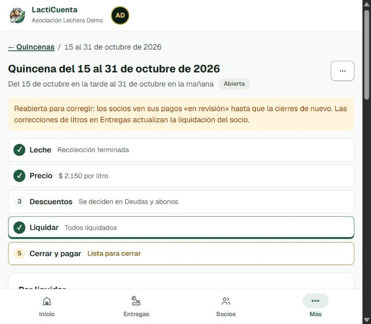
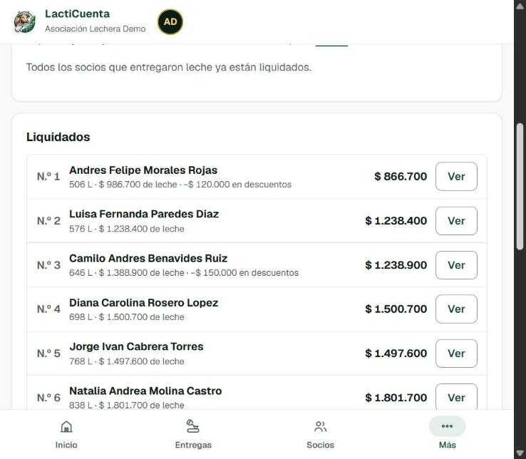
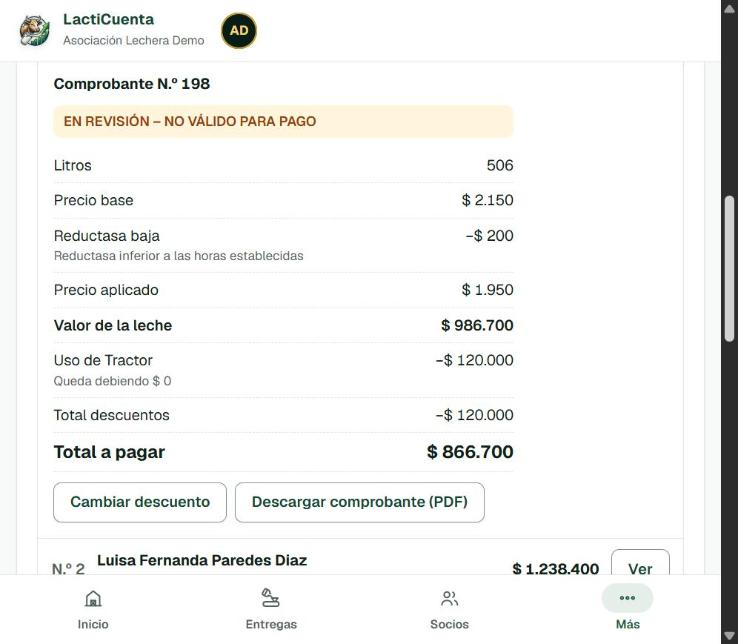
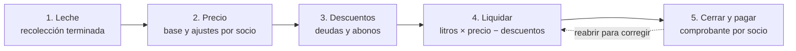
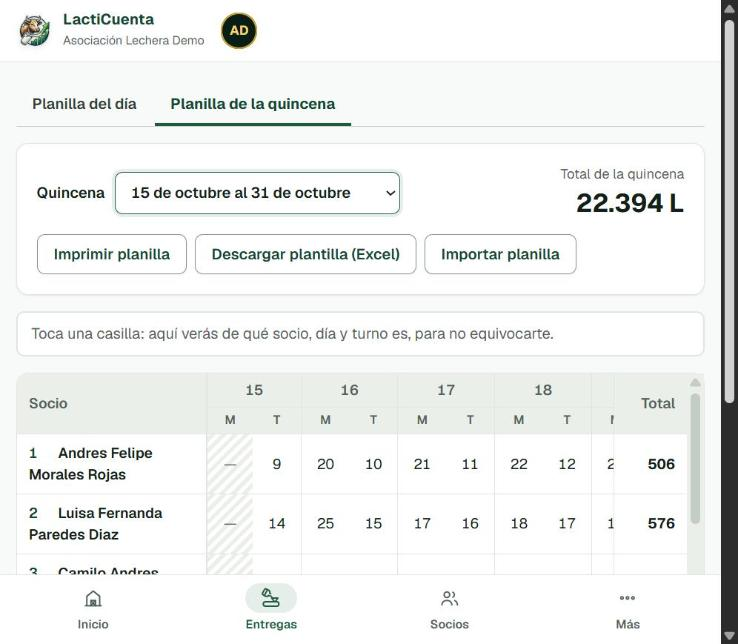
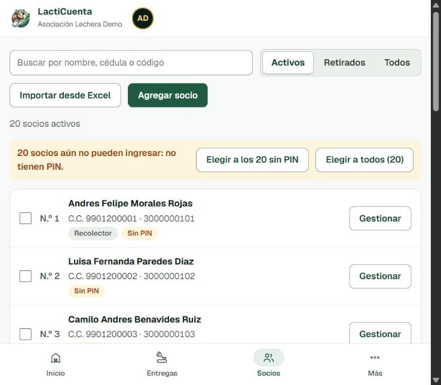
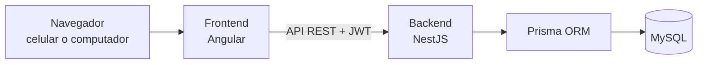

# LactiCuenta

Sistema web para que las asociaciones lecheras registren la leche que entregan sus socios y liquiden el pago de cada quincena.

**Estado:** en producción con varias asociaciones lecheras de Nariño, Colombia. En mejora continua.
**Código fuente:** privado. Este repositorio documenta el producto y sus decisiones técnicas. Si estás evaluando mi perfil, puedo darte acceso de lectura temporal o mostrarte el código en una sesión.

  
  
  

> Las capturas son de una asociación de demostración con datos ficticios.

## El problema

En muchas asociaciones lecheras del sur de Colombia, la leche que entrega cada socio se anota a mano dos veces al día. Al cerrar la quincena, alguien suma litros, aplica el precio de cada socio con sus ajustes por calidad, resta lo que debe (anticipos, uso del tractor, insumos) y calcula cuánto pagarle. Todo en cuaderno o en hojas de cálculo.

Ese proceso toma horas y es fácil equivocarse. Además, el socio no tiene cómo consultar lo que entregó hasta que recibe el pago.

## La solución

| Rol | Qué hace en el sistema |
| --- | --- |
| Administrador | Registra socios (también desde Excel), define precios y ajustes, maneja deudas y abonos, y cierra la quincena. |
| Recolector | Registra los litros de cada socio en el turno de la mañana y de la tarde, en una planilla diaria o quincenal. |
| Socio | Entra con su cédula y un PIN y consulta sus entregas, su liquidación y su comprobante. |

El cierre de cada quincena sigue cinco pasos. Una quincena cerrada se puede reabrir para corregir; mientras tanto, los socios ven su pago como «en revisión».

El sistema no maneja dinero: el pago se sigue haciendo en efectivo. Lo que hace es calcularlo bien y dejar trazabilidad.

  
  

## Arquitectura

- **Backend:** NestJS con TypeScript. Monolito modular (unos 20 módulos), cada uno organizado en controlador, servicio y repositorio.
- **Persistencia:** Prisma sobre MySQL, con el esquema versionado mediante migraciones.
- **Frontend:** Angular, pensado primero para celular. Solo muestra datos: todos los cálculos de litros y de dinero se hacen en el backend, para que haya una única fuente de verdad.
- **Multi-asociación:** varias asociaciones comparten la misma instalación y cada una solo ve sus propios datos.

## Decisiones técnicas

Lo más delicado del sistema es que calcula dinero que reciben personas reales. Por eso:

- **Sin decimales flotantes:** litros y valores se guardan como enteros y se operan con `decimal.js`, para evitar errores de redondeo.
- **Una sola liquidación vigente** por socio y quincena, garantizada por un índice único en la base de datos.
- **Bloqueo al liquidar:** la quincena se bloquea con `SELECT … FOR UPDATE`, para que dos operaciones al mismo tiempo no generen resultados distintos.
- **Verificación de cuadre** antes de confirmar el cierre.
- **Historia inmutable:** una liquidación no se edita, se anula y se reemplaza. La auditoría se registra en la misma transacción.
- **Seguridad:** contraseñas con Argon2id, PIN de socios con bcrypt, autenticación JWT, validación estricta de las entradas y aislamiento de datos entre asociaciones.

## Calidad y operación

- Más de 350 pruebas unitarias entre backend y frontend (octubre de 2026), además de pruebas end-to-end del backend.
- Integración continua con GitHub Actions para backend y frontend.
- Copias de seguridad automáticas de la base de datos.
- Trabajo con ramas y pull requests.
- Entorno local con Docker Compose.

## Mi rol

Proyecto propio. Hice el levantamiento de requisitos directamente con una asociación lechera, el diseño del modelo de datos, el backend, el frontend y el despliegue.

## Stack

TypeScript · NestJS · Prisma · MySQL · Angular · Docker · GitHub Actions

## Contacto

[LinkedIn](https://www.linkedin.com/in/alexander-taimal) · alexandertaimal23@gmail.com
